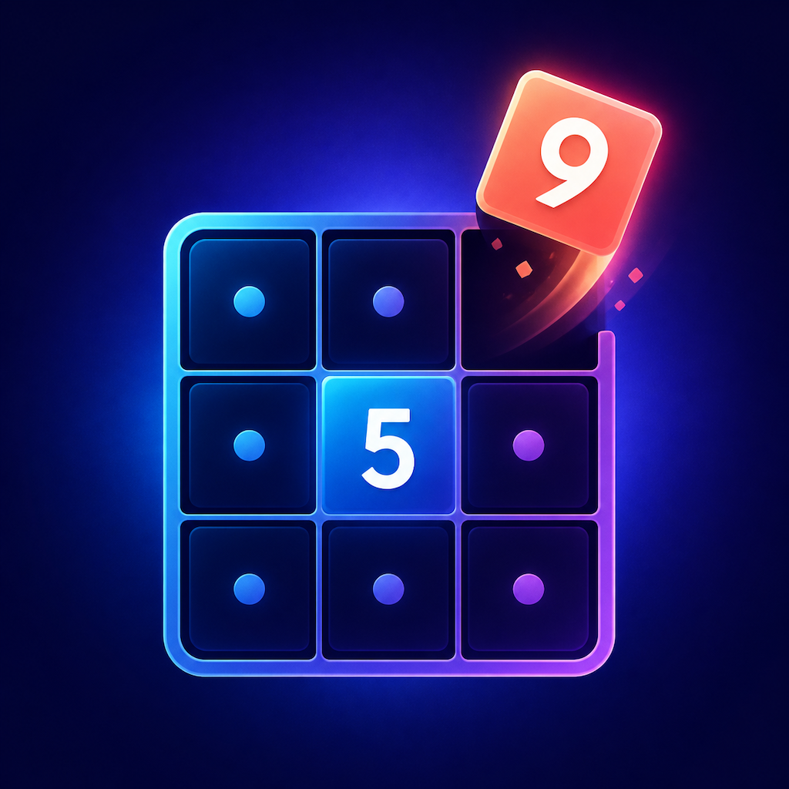

  

<h1 align="center">Not Another Sudoku</h1>

  Sudoku for iPhone and iPad, from quick mini puzzles to full-size challenges.

  <a href="https://mythodeia.github.io/not-another-sudoku-privacy/support.html">Support</a>
  ·
  <a href="https://mythodeia.github.io/not-another-sudoku-privacy/">Privacy Policy</a>

## Find your way to play

Not Another Sudoku brings together daily puzzles, several game modes, multiplayer, and visual customization. Settle into a relaxed solo session, challenge yourself against the clock, or share a puzzle with a friend.

- **Three board sizes:** choose a quick 4×4, a 6×6 puzzle, or a classic 9×9 board, with a range of difficulty levels.
- **Five game modes:** play Classic, Timed, Hardcore, Zen, or Fog. Race the countdown in Timed, or uncover the board as you solve in Fog.
- **Daily Challenges:** return for a shared daily puzzle, track results in the calendar, and collect monthly trophies.
- **Race a Friend:** compete head-to-head through Apple Game Center.
- **Co-op:** work together on a shared puzzle through Game Center.
- **Helpful solving tools:** pencil notes, automatic notes, technique-aware hints, undo and redo, and configurable highlighting.
- **Puzzle sharing:** share challenges using links and QR codes, and save favorite puzzles to revisit.

## Make it yours

- Customize grid themes, number styles, accent colors, backgrounds, and app icons.
- Choose light or dark appearance, including custom photo backgrounds.
- Enjoy soundscapes, sound effects, haptics, and completion celebrations.
- Earn XP, levels, achievements, and coins to unlock cosmetic options.
- Track play streaks, history, best times, and statistics by board size and difficulty.
- Use Dynamic Type and VoiceOver support to suit the way you play.

## Keep your progress

Solo puzzles can be played offline. Progress is stored locally, with optional private iCloud synchronization between your devices. You can also export and import backups. Game Center multiplayer requires an internet connection.

## Get help

Visit the [Support page](https://mythodeia.github.io/not-another-sudoku-privacy/support.html) for troubleshooting guidance and frequently asked questions, or email [notanothersudoku@gmail.com](mailto:notanothersudoku@gmail.com).

Inside the app, open **Settings → Support & Diagnostics → Email Support** to prepare a support email with diagnostic logs attached.

Read the [Privacy Policy](https://mythodeia.github.io/not-another-sudoku-privacy/) for details about local storage, optional iCloud sync, Game Center, and support correspondence.

## About this repository

This repository hosts the app's public support and privacy pages on GitHub Pages. The app's source code is maintained separately.

© 2026 Konstantinos Koronellos. All rights reserved.
